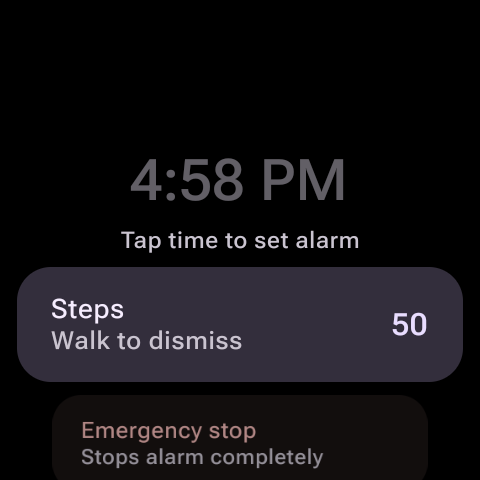
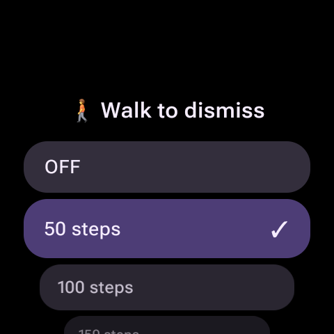

# WakeGuard

A standalone Wear OS alarm app for Samsung Galaxy Watch that actually makes you get up. Set a wake-up time, and when it rings, you have to **walk** to dismiss it. No snooze button, no cheating.

<p align="center">
  
  &nbsp;&nbsp;
  
</p>

## How It Works

1. **Set your alarm** — tap the time to toggle on/off, tap "Change time" for a 12-hour scroll picker.
2. **Choose your step challenge** — pick 50, 100, 150, or 200 steps, or turn it off.
3. **Go to sleep** — the app doesn't run overnight. The alarm is held by the system.
4. **Wake up** — the watch vibrates and plays an alarm tone for 45 seconds.
5. **Walk to dismiss** — if you don't hit your step target within 5 minutes, it rings again. And again. Up to 9 times or 45 minutes.
6. **Emergency stop** — for when you really need to kill it.

## Features

- **Step challenge** — configurable step target (50–200) to dismiss the alarm
- **Repeat rings** — alarm keeps coming back every 5 minutes until you walk enough
- **Motion detection** — accelerometer-based wakefulness heuristic as a fallback
- **Alarm tone + vibration** — both fire together for 45 seconds
- **Screen wake** — watch screen turns on when the alarm fires
- **Mute button** — silence the tone while still tracking steps
- **Boot recovery** — alarm survives watch restarts
- **No phone needed** — fully standalone on the watch

## Supported Devices

- Samsung Galaxy Watch 8 (tested)
- Wear OS 6+ (Android 16, API 36) or Wear OS 7 (Android 17, API 37)
- Should work on other Wear OS watches, but only tested on Galaxy Watch 8

## Build & Install

### Prerequisites

- Android Studio (current stable)
- Android SDK with platforms 36 and 37
- JDK 17+

### Build

```bash
./gradlew :app:assembleDebug
```

The APK is at `app/build/outputs/apk/debug/app-debug.apk`.

### Install on Watch

Enable **Developer options** and **Wireless debugging** on the watch:

```bash
adb pair <watch-ip>:<pair-port>
adb connect <watch-ip>:<debug-port>
adb install -r app/build/outputs/apk/debug/app-debug.apk
```

### Run Tests

```bash
./gradlew :app:testDebugUnitTest
```

## Permissions

| Permission | Why |
| --- | --- |
| `USE_EXACT_ALARM` | Schedule alarm while the app isn't running |
| `POST_NOTIFICATIONS` | Show alarm notification with actions |
| `VIBRATE` | Alarm haptics |
| `FOREGROUND_SERVICE` | Keep the alarm session alive during monitoring |
| `WAKE_LOCK` | Wake the screen when the alarm fires |
| `RECEIVE_BOOT_COMPLETED` | Reschedule alarm after watch restart |
| `ACTIVITY_RECOGNITION` | Count steps for the walk-to-dismiss challenge |
| `USE_FULL_SCREEN_INTENT` | Show the alarm screen over the lock screen |

## How the Wakefulness Heuristic Works

The accelerometer detects movement after the vibration stops. A sample is "active" when linear acceleration exceeds 0.8 m/s² or the gravity vector turns faster than 30°/s. Quick twitches under 0.6s are ignored.

You're considered **awake** when:
- You press Stop, or
- 3+ movement bursts span at least 40 seconds with 12+ seconds of activity, or
- One continuous burst lasts 25+ seconds

Rolling over once won't trick it. Lying still while awake won't dismiss it. That's the point.

## Architecture

```
AlarmScheduler          → setExactAndAllowWhileIdle
AlarmReceiver           → starts AlarmSessionService
AlarmSessionService     → vibrate + tone, step detection, repeat scheduling
AlarmActivity           → shows step progress, mute/stop buttons
AlarmSettings           → SharedPreferences wrapper
Notifications           → alarm + progress notification channels
BootReceiver            → reschedules on reboot/timezone change
WakefulnessDetector     → motion heuristic (unit tested)
MotionSensorManager     → accelerometer sampling
```

## Contributing

Contributions are welcome! This is a personal project, but if you find it useful:

1. Fork the repo
2. Create a feature branch
3. Test on a real watch (emulators don't reproduce Wear OS background limits)
4. Open a PR

## License

[MIT](LICENSE) — do whatever you want with it.
